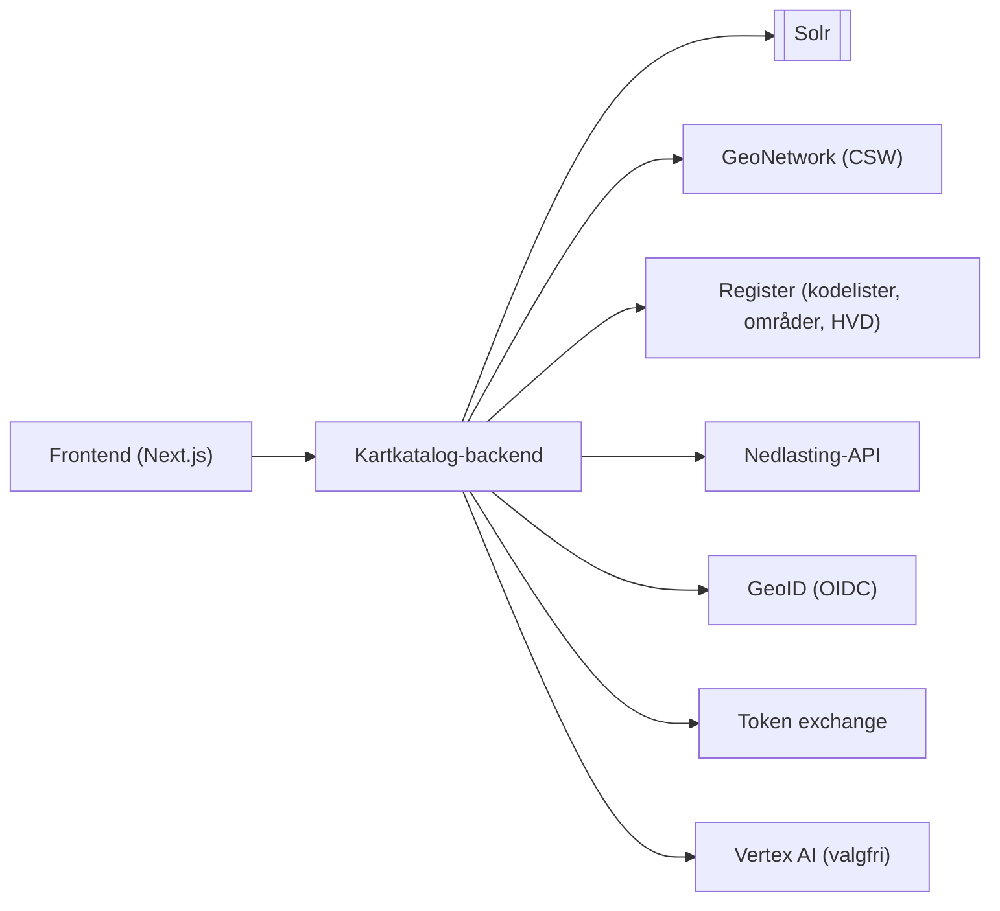

# Kartkatalog-backend

## Beskrivelse

Ktor-basert API for søk og visning av metadata som er registrert i GeoNetwork (indeksert i Solr), samt bestilling av nedlasting og GeoID-innlogging. Backend brukes av [frontend](../../frontend/docs/frontend.md) (Next.js) og med rammer for bruk av eksterne konsumenter som er avhengige av legacy-kontrakten (`/search`, `/api/datasets-simple`, `/api/metadata/{uuid}`).

API-dokumentasjon (Swagger/OpenAPI genereres fra KDoc på rutene).

## Teknologi

| Kategori | Teknologi |
|---|---|
| Språk / runtime | Kotlin 2.4, JVM 25 |
| Rammeverk | Ktor (Netty), Content Negotiation (kotlinx.serialization), Call Logging, Status Pages, CORS, ForwardedHeaders |
| Autentisering | Ktor `server-auth-oidc` mot GeoID (OIDC, session-cookie `GEOID_SESSION`) |
| HTTP-klient | Ktor client (CIO) |
| Søk | Solr (kjerner `metadata_all` / `metadata_all_en` / `metadata`), der metadata er indekserte datasett og metadata_all inkluderer alle typer (dataset, series, software, service). Valgfritt vektorsøk med Vertex AI embeddings (`google-genai`med text-multilingual-embedding-002 som embeddingmodell) |
| Konfigurasjon | `.env` / miljøvariabler via `dotenv-kotlin` |
| Kodekvalitet | ktlint (`./gradlew ktlintCheck` / `ktlintFormat`) |
| Test | `kotlin.test`, Ktor `testHost` og `client-mock` |
| Bygg / kjøring | Gradle, fat-jar (`application.jar`), Docker (multi-stage, kjører ktlint + test ved bygg) |

Versjoner: se [`build.gradle.kts`](../build.gradle.kts) og [`gradle/libs.versions.toml`](../gradle/libs.versions.toml).

## Avhengigheter (eksterne systemer)



| System | Brukes til | Miljøvariabel |
|---|---|---|
| GeoNetwork | Henter full metadatapost (CSW) | `GEONETWORK_BASE_URL` |
| Solr | Søk, fasetter, distribusjoner, tilknyttede distribusjoner | `SOLR_BASE_URL` |
| Register | Kodelister/oversettelser, områder, HVD, innsiktsgrupper | `REGISTER_BASE_URL` |
| Norgeskart | Kartlenker i svar | `NORGESKART_BASE_URL` |
| Nedlasting-API | Nedlastingsbestilling og alternativer | Ingen relatert |
| GeoID | Innlogging (OIDC) | `GEOID_ISSUER`, `GEOID_CLIENT_ID`, `GEOID_CLIENT_SECRET` |
| Token exchange | Bytter GeoID-token for nedlastingstoken | `TOKEN_EXCHANGE_URL` |
| Vertex AI | Embeddings til vektorsøk | `VECTOR_SEARCH_ENABLED`, `VERTEX_AI_PROJECT_ID` (+ valgfrie `VERTEX_AI_*`, `VECTOR_*`) |

Andre variabler: `PUBLIC_BASE_URL` (offentlig URL; OIDC-redirect/CSRF og lenker i legacy-søk), `KARTKATALOG_BASE_URL` (valgfri, legacy-lenker), `ALLOWED_DOWNLOAD_CLIENTS` (valgfri). Kopier `.env.example` → `.env`. Manglende påkrevde variabler gir feil ved oppstart.

## Kodestruktur

```
src/main/kotlin/no/kartverket/geonorge/kartkatalog/
├── config/          AppConfig, auth, CORS, serialisering, status pages
├── auth/            /api/me/geoid, token exchange
├── search/          Søk (moderne + legacy-kompatibelt), CSV, språk, Solr-spørringer
├── metadata/        Metadatamapping, kodelister, tilgangsstatus, tegneregler m.m.
├── distribution/    Distribusjoner for et metadata-objekt
├── download/        Nedlastingsbestilling og -alternativer
└── integrations/    Klienter: geonetwork, solr, register, vertex
```

## Tilgjengeliggjorte endepunkt

| Endepunkt | Beskrivelse | Brukes av |
|---|---|---|
| `GET /api/search` | Søk (JSON camelCase, eller CSV via `Accept`/`mediatype`) | Frontend (søk, autocomplete via `/bff/search`) |
| `GET /search` | Legacy-kompatibelt søk (PascalCase, legacy-parametre) | Eksterne konsumenter av legacy `/api/search` |
| `GET /api/datasets-simple` | Legacy-kompatibelt forenklet datasettsøk | Eksterne konsumenter |
| `GET /api/metadata/{uuid}` | Legacy-kompatibelt oppslag av én post | MetadataEditor, Geonorge.ApiServices |
| `GET /metadata/{uuid}` | Mappet metadatapost | Frontend (detaljside, nedlastingskurv) |
| `GET /metadata/{uuid}/linked-distributions` | Tilknyttede distribusjoner | Frontend (detaljside) |
| `GET /metadata/{uuid}/tegneregler`, `/produktark`, `/produktspesifikasjon` | Dokumentasjon knyttet til posten | Frontend (detaljside) |
| `GET /api/distributions/{uuid}` | Distribusjoner for en post | Ikke funnet brukt i frontend |
| `GET /api/download/options/{uuid}` | Nedlastingsalternativer (krever kapabilitets-URL) | Frontend (`/nedlasting`) |
| `GET /api/download/insight-groups` | Innsiktsgrupper | Frontend (`/nedlasting`) |
| `POST /api/download/order` | Bestill nedlasting (innlogging valgfritt) | Frontend (`/bff/download/order`) |
| `POST /api/download/order-restricted` | Bestill begrenset nedlasting (Bearer GeoID-token) | Frontend (`/bff/download/order-restricted`) |
| `GET /api/me/geoid` | Innlogget GeoID-bruker | Frontend (`AuthProvider`) |
| `GET /auth/geoid/login`, `/auth/geoid/logout` | Start innlogging / utlogging (OIDC-plugin) | Frontend (`/bff/auth/...`) |
| `GET /` | Helsesjekk (Docker `HEALTHCHECK`) | Container |
| `GET /swagger` | Swagger UI | Utviklere |

Interne ruter (`/bff`, `/auth`, `/api/me`, `/api/download`) holdes utenfor Swagger.

## Valg og beslutninger

- **Ktor/Kotlin i stedet for ASP.NET** – modernisering av legacy Kartkatalog.
- **Frontend går via BFF** – nettleseren snakker ikke direkte med backend (se frontend-dokumentasjonen).
- **To søkekontrakter** – `/api/search` er ny; `/search` bevarer legacy-kontrakten slik at eksisterende konsumenter ikke brytes. De deler Solr-utførelse, men har egne spørringsbyggere.
- **OpenAPI fra KDoc** – `codeInferenceEnabled = false`; parametere og svar må dokumenteres eksplisitt og holdes i synk med handlerne.
- **Vektorsøk er valgfritt** (`VECTOR_SEARCH_ENABLED`, default av). Feiler Vertex-klienten ved oppstart, logges en advarsel og vektorsøk slås av.
- **Allowlist for token** – GeoID-token sendes kun til HTTPS-origins i `ALLOWED_DOWNLOAD_CLIENTS`.
- **Jackson-BOM låst** til sikker versjon (CVE) fordi `auth.oidc` drar inn en eldre; fjern når oidc oppdateres.
- **Ingen indeksering her** – backend leser kun Solr. Indeksering vedlikeholdes av eksisterende Solr-oppsett (se legacy-dokumentasjon).

## Ting man kan stusse ved

- **Både `/search` (legacy) og `/api/search` (ny)** finnes. Ulikt JSON-format (PascalCase vs camelCase) og ulik feilhåndtering: `/api/search` → 502 ved Solr-feil; `/search` → tomt 200-svar; `/api/datasets-simple` og `/api/metadata/{uuid}` → 204.
- **Språk:** `lang` → `_culture`-cookie → `Accept-Language` → norsk. `/api/search` JSON er alltid norsk; CSV og legacy-ruter følger valget (engelsk bruker `metadata_all_en`).
- **CSV:** wildcard i `Accept` velger ikke CSV, `q=0` ekskluderer, `mediatype` overstyrer `Accept`. Kun etterspurt side eksporteres; tomt resultat gir tom body.
- **`offset` er 1-basert**; `limit` klemmes til 1–1000.
- **`/metadata/{uuid}` har ikke `/api`-prefiks**, i motsetning til de fleste andre.
- **CORS er `anyHost()`.** Innlogging beskyttes av session-cookie + CSRF-origin, ikke CORS.
- **Oppstart feiler uten påkrevde miljøvariabler**, og OIDC-discovery forsøkes 3 ganger (5 s mellomrom) – GeoID må være nåbar.
- **`src/test/resources/response*.xml`** er CSW-eksempelsvar til `MetadataParserTest`.
- **JVM 25 og `-Xcontext-parameters`** brukes; eldre JDK-er fungerer ikke.

## Annen dokumentasjon

- [Ktor](https://ktor.io/docs/home.html) og [OpenAPI-generering](https://ktor.io/docs/openapi-spec-generation.html)
- Frontend: [`frontend/docs/frontend.md`](../../frontend/docs/frontend.md)
- Backend README (søk/legacy-kompatibilitet i detalj, begrensede nedlastinger): [`../README.md`](../README.md)
- Legacy: [Geonorge.Kartkatalog](https://github.com/kartverket/Geonorge.Kartkatalog), Solr-oppsett: [Geonorge.Kartkatalog.Solr](https://github.com/kartverket/Geonorge.Kartkatalog.Solr)
- Backstage: [`catalog-info.yaml`](../../catalog-info.yaml)
